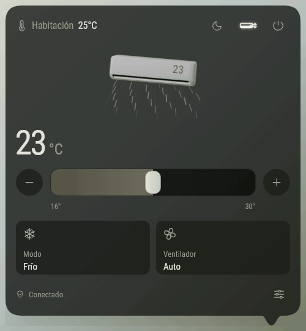
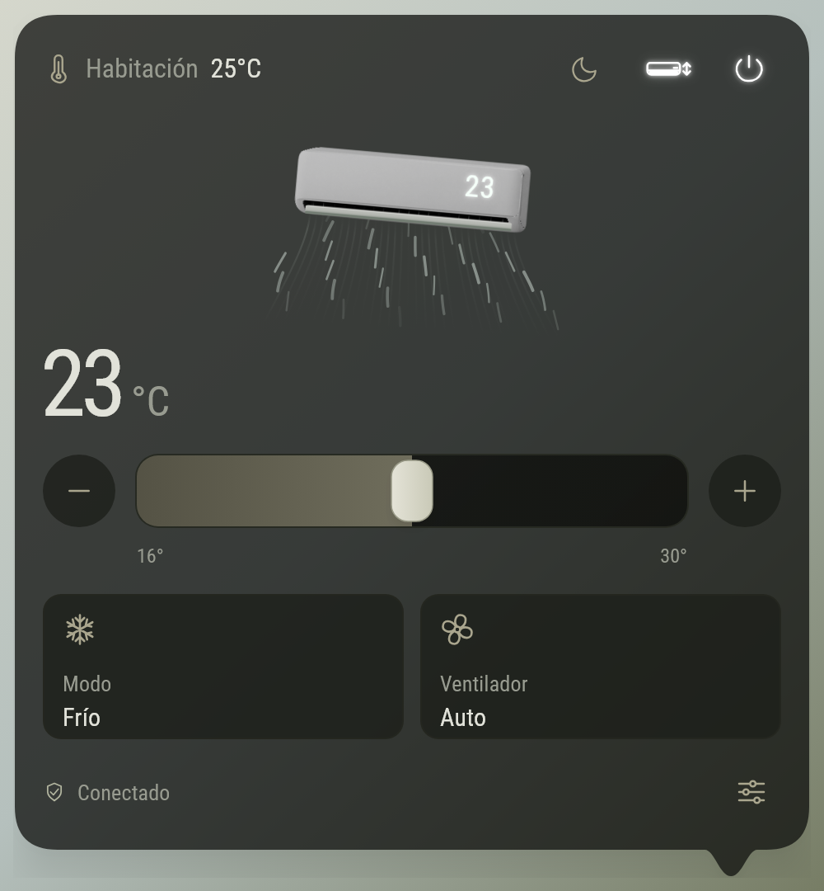
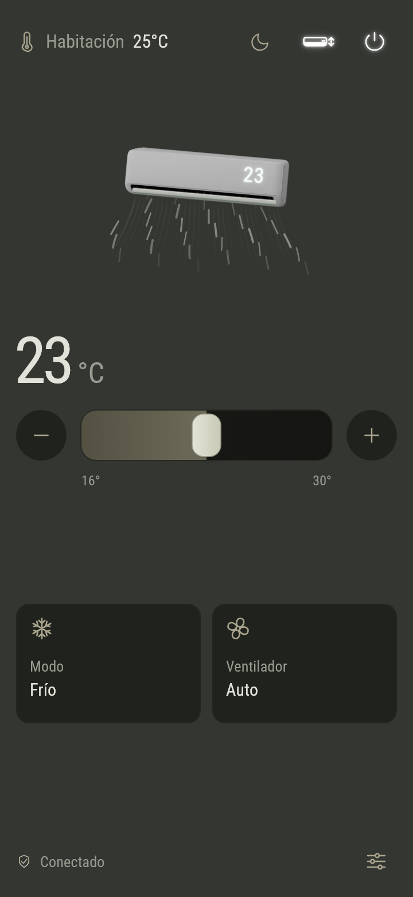
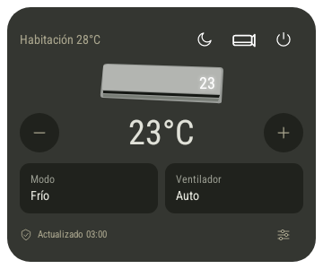
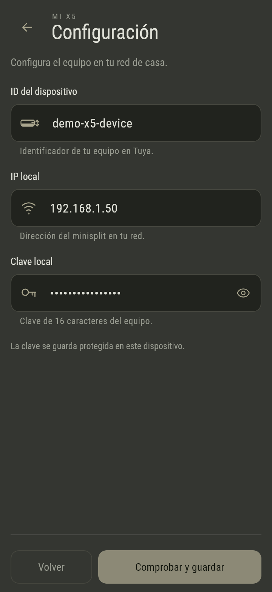

# Mi X5

* Control local por Wi-Fi para el Mirage Inverter X5, con una interfaz animada para escritorio, app Android y widget de inicio.

[English](README.en.md) · [Compilación](docs/BUILDING.md) · [Configurar un equipo](docs/DEVICE_SETUP.md) · [Protocolo y compatibilidad](docs/PROTOCOL.md)

<p align="center"></p>

El perfil implementado se ha probado con el **Mirage Inverter X5 CVF121Q, solo frío, Tuya 3.5**. Cada instalación se configura con el ID, la IP local y la clave local de su propio equipo. El tráfico de control va directamente al minisplit dentro de la red local; la app no utiliza credenciales de Tuya Cloud durante su funcionamiento.

## Una interfaz para cada pantalla

| Escritorio | Android | Widget Android |
| :---: | :---: | :---: |
|  |  |  |

Las imágenes y el GIF muestran widgets Flutter con **datos simulados**, sin credenciales reales. La imagen del widget proviene de una prueba en emulador. El fondo neutro del ejemplo de escritorio permite apreciar la transparencia; el blur nativo depende de Windows.

- **Windows:** icono de minisplit junto al reloj, panel que se oculta al perder el foco y punta que sigue la posición de la bandeja. Fondo oscuro translúcido y blur recortado en Windows 11.
- **Android:** interfaz que ocupa la pantalla, fondo sólido, controles táctiles y configuración con desplazamiento.
- **Widget Android:** encendido, temperatura, modo, ventilador, Sueño, oscilación y display sin abrir la app. Consulta el equipo al usarlo; no mantiene un sondeo permanente.
- **macOS:** proyecto Xcode, barra de menús, Keychain y permisos de red preparados. **Pendiente de compilar y comprobar en una Mac.** El blur de Windows no está implementado para macOS.

## Controles

| Función | Implementación |
| --- | --- |
| Encendido y apagado | Botón en la cabecera |
| Temperatura | Barra y botones ±, limitada a 16–30 °C |
| Modo | Frío, Automático, Deshumidificar y Solo ventilador |
| Ventilador | Automático, Silencioso, Bajo, Medio, Alto y Turbo |
| Sueño | Luna en la cabecera |
| Oscilación vertical | Botón de minisplit con flechas; movimiento o posición fija |
| Display del equipo | Pulsar los números del render |
| Estado | Conectado, Sincronizando o error; pulsar para actualizar |

Al pasar el mouse por Modo o Ventilador, su tarjeta se expande dentro de la fila. En Android se abre con un toque. El render abre y cierra el aspa, anima el aire y acompaña la oscilación. Las animaciones respetan movimiento reducido y se pausan al ocultar los controles.

**Límites de compatibilidad:** tener Wi-Fi o usar Smart Life no garantiza que otro modelo admita este perfil. Calor y oscilación horizontal están excluidos del CVF121Q. No se encontró un comando Wi-Fi para Eco I/II; las capturas infrarrojas se conservan como investigación separada. [Detalles y evidencia](docs/PROTOCOL.md).

## Empezar desde el código

Herramienta de referencia: **Flutter 3.29.2 / Dart 3.7.2**. Conserva `pubspec.lock` y los dos paquetes locales de `vendor/`.

```sh
git clone https://github.com/Frankz1997/mi-x5.git
cd mi-x5
flutter pub get
```

En Windows:

```sh
flutter run -d windows
```

En una Mac con Xcode y CocoaPods configurados:

```sh
flutter doctor -v
flutter run -d macos
flutter build macos --release
```

En Android, conecta un dispositivo o inicia un emulador y ejecuta `flutter run`. Los requisitos, las rutas de salida y los problemas habituales están en [la guía de compilación](docs/BUILDING.md).

## Conectar el minisplit

1. Vincula el equipo a Smart Life y conecta el teléfono o computadora a la misma red local.
2. Obtén el **ID del dispositivo** y su **clave local** mediante tu propio proyecto vinculado en Tuya Developer. Consulta la IP del equipo en tu router.
3. Abre Configuración, introduce los tres datos y pulsa **Comprobar y guardar**. Se valida la conexión antes de guardarla.

<details>
<summary>Ver Configuración con datos de ejemplo</summary>

<p align="center"></p>

</details>

La clave queda protegida en el dispositivo. **No se incluye ninguna conexión real en el repositorio.** El formato de configuración anterior sigue siendo legible al actualizar. En otra computadora, incluida una Mac, hay que configurar la conexión nuevamente: el archivo cifrado de Windows está ligado a esa cuenta de Windows. [Guía completa](docs/DEVICE_SETUP.md).

## Verificación y estado

- Las pruebas automatizadas usan clientes falsos o un simulador Tuya 3.5 limitado a loopback; no operan un minisplit real.
- Las pruebas físicas anteriores del CVF121Q confirmaron lectura autenticada, aceptación de los controles y movimiento/detención de la oscilación vertical por Wi-Fi.
- El widget 0.2.1 se verificó con clics reales en un emulador Android 16, app cerrada y red simulada; también se comprobó recuperación sin conexión y cierre del servicio. Falta confirmar ese resultado con el S23 físico y el minisplit.
- macOS todavía no se ha compilado ni ejecutado. No se comprobó el uso con la salida a internet del router desconectada.

```sh
flutter analyze lib test tool
flutter test
```

Consulta [las pruebas y capturas reproducibles](docs/TESTING.md). El [HTML original](ui-preview/README.md) es una maqueta interactiva sin conexión al equipo.

## Estructura

```text
lib/          App Flutter, controles Tuya y comunicación con el widget
windows/      Ventana nativa y blur de Windows
android/      App, widget y servicio temporal de comandos
macos/        Runner de macOS preparado, sin validación en hardware
test/         Pruebas de lógica, UI y protocolo con datos ficticios
tool/         Simulador, capturas de documentación e investigación IR
ui-preview/   Prototipo HTML/CSS/JS del diseño
vendor/       Dependencias locales modificadas y sus licencias
docs/         Guías, notas del protocolo y galería
```

## Contribuir y licencia

Los cambios de perfil necesitan evidencia del dispositivo y pruebas de regresión. Consulta [CONTRIBUTING](CONTRIBUTING.md) y [SECURITY](SECURITY.md). No incluyas claves reales, configuraciones privadas ni archivos de firma en issues o contribuciones.

Código original bajo [MIT](LICENSE). Las dependencias y recursos conservan sus propias licencias: [créditos y avisos](THIRD_PARTY_NOTICES.md). Proyecto comunitario independiente, sin afiliación con Mirage o Tuya.
